# Kolmogorov n-widths of Navier–Stokes solution sets: numerical experiments

Numerical evidence for the exponential decay of the Kolmogorov n-widths of the
solution set of the steady incompressible Navier–Stokes equations

$$-2\nu\,\mathrm{div}\,\varepsilon(u) + (u\cdot\nabla)u + \nabla p = f, \qquad \mathrm{div}\,u = 0,$$

when the source terms $f$ range over a bounded set of analytic functions that
satisfies the small data assumption. The upper bounds of the n-widths are the
maximum POD projection errors of the computed solutions.

## Result

Let $\Omega$ be a plane polygon with homogeneous no-slip, slip or open boundary
conditions (mixed, possibly changing type at the corners), and let the source
terms range over a compact set of corner-weighted analytic functions
$f \in [B^0_\beta(\Omega; C_f, A_f)]^2$ that satisfies the small data assumption.
By the weighted analytic regularity of the Leray–Hopf solutions [1, 2], the
solution set $K$ is a compact subset of $[B^2_\beta(\Omega)]^2 \times B^1_\beta(\Omega)$,
and the exponential convergence of $hp$-finite elements on geometric meshes
gives the bound on its Kolmogorov n-widths

$$d_n\big(K, H^1(\Omega)^2 \times L^2(\Omega)\big) \le C \exp\big(-b\, n^{1/3}\big), \qquad n \ge 1,$$

with $b, C > 0$ depending only on $C_f$, $A_f$, $\nu$ and $\Omega$. For a finite
solution set $K_N$ the maximum POD projection errors $E^u_n$, $E^p_n$ of the
discrete snapshots bound the n-width from above and below:

$$\frac{E^u_n + E^p_n}{2\sqrt{N}} - \varepsilon_{K_N} \le d_n\big(K_N, H^1(\Omega)^2 \times L^2(\Omega)\big) \le E^u_n + E^p_n + \varepsilon_{K_N}.$$

The source terms are a $K = 495$-dimensional **corner-scale parameter space**
(see [Method](#method)): Laplace eigenfunctions multiplied by Gaussian bumps in
$\log r$ at the scales $r_j = R_0 2^{-j}$ of the distance $r$ from a re-entrant
corner. It lies in a fixed analytic class $B^0_\beta$. The scales reach
$r_{14} = 2^{-14} R_0 \approx 6 \cdot 10^{-5} R_0$, so the solution sets
resolve the corner singularity over many scales:

* **Navier–Stokes**: with N = 750 the errors decay by about seven orders of
  magnitude between $n = 100$ and $n \approx 700$, without levelling off at
  $n = K$. On these windows the fit $e^{-b n^{1/3} - c}$ has a 2–3 times smaller
  rms than $e^{-b n^{1/2} - c}$ (no-slip, mixed and cube slip: 0.06–0.10
  against 0.13–0.26; backward step with slip walls, fitted only on
  $100 \le n \le 300$: 0.17–0.19 against 0.23–0.25). On the shorter
  windows $n \le 470$ of the N = 500 figures (viscosity, cube mesh) the two
  fits are close: the velocity still favours $n^{1/3}$, the pressure slightly
  $n^{1/2}$ ([Decay rates](#decay-rates)). The rate $b \approx 3.6$–$5$ does
  not depend on the viscosity: in the small data regime the solution set at
  viscosity $\nu$ is $\nu$ times the one at $\nu = 1$.
* **Stokes** (same source terms): the solution set lies in a $K$-dimensional
  space, $d_n = 0$ for $n \ge K$; the errors drop to round-off already at
  $n \approx 155$–$180$, much faster than the Navier–Stokes errors.

## Method

For each benchmark (geometry, boundary conditions and mesh):

1. **Small data constants** on the discrete velocity space
   $W_h = \{v_h \in [P_2]^2 \text{ with the essential b.c.}\}$ of the base mesh,
   with the full $H^1$ norm ([knwins/constants.py](knwins/constants.py)):
   * coercivity $C_\mathrm{coer} = \min_{v} 2\|\varepsilon(v)\|^2 / \|v\|_{H^1}^2$ (generalized eigenvalue problem);
   * continuity $C_\mathrm{cont} = \sup_{u,v,w} \int (u\cdot\nabla)v\cdot w \,/\, (\|u\|\|v\|\|w\|)$:
     lower estimate by an alternating higher-order power method (HOPM).

   The threshold of the small data assumption is $\tau = \nu^2 C_\mathrm{coer}^2 / (4 C_\mathrm{cont})$.
   The constants do not change under mesh refinement (`cube_dirichlet` and
   `cube_dirichlet_fine` below).
2. **Graded mesh** ([knwins/benchmarks.py](knwins/benchmarks.py)): the base mesh
   is refined towards the re-entrant corner $c_\iota$ until
   $h \le \max(0.12\, r, 5\cdot10^{-7} H)$ for $r = |x - c_\iota| < H/4$
   ($H$ the channel height), so that the smallest corner scale is resolved.
   The graded meshes are in [meshes/graded/](meshes/graded/).
3. **Source terms** ([knwins/sources.py](knwins/sources.py)): with $\varphi_k$ the
   Dirichlet Laplace eigenfunctions ($\lambda_1 \le \lambda_2 \le \dots$) and the
   corner scales
   $\chi_j(x) = \exp\big(-\log_2(r_j/r)^2 / (2 s^2)\big)$, $r_j = R_0 2^{-j}$, $R_0 = 0.1 H$,

   $$f(y) = \sigma \sum_{k \le 33,\ j < 15} y_{kj}\, a_{kj}\, (\varphi_k \chi_j, 0), \qquad \|a_{kj} (\varphi_k\chi_j, 0)\|_{W_h^*} = \frac{\tau}{K}, \qquad y \in \{-1, 1\}^{K},$$

   $K = 495$, $s = 0.25$. The parameters $y_1, \dots, y_{750}$ are random (seed 0)
   and the same in every study, and $\sigma = \tau / \max_{i \le 750} \|f(y_i)\|_{W_h^*}$
   puts the largest source term on the small data threshold. Each $\varphi_k$ lies
   in $B^0_\beta(\Omega)$, multiplication by $\chi_j$ keeps it there with constants
   independent of $j$ (the holomorphic extension of $\chi_j$ to a polydisc of radius
   $r/8$ is bounded by $e^{0.02/(s \ln 2)^2} \approx 1.95$), and so does the linear
   combination: the parameter space is a compact subset of a fixed analytic class.
4. **High-fidelity snapshots** ([knwins/solvers.py](knwins/solvers.py)): Taylor–Hood $P_2/P_1$,
   Newton's method from a zero initial guess, relative tolerance $10^{-8}$; the
   Stokes snapshots for the same source terms with the same discretization.
5. **Weighted POD** ([knwins/pod.py](knwins/pod.py)): SVD in the $H^1$ inner product for the
   velocity and the $L^2$ inner product for the pressure, and the maximum projection errors
   $\varepsilon(n) = \max_j \|s_j - \Pi_n s_j\|$ over the $N$ training snapshots.
6. **Decay fits** ([knwins/pod.py](knwins/pod.py)): least-squares fits
   $\varepsilon(n) \approx e^{-b n^a - c}$, $a = 1/3$ and $a = 1/2$, of $\log\varepsilon(n)$,
   with the rms of the residual. Navier–Stokes: on $100 \le n$ until the decay clearly
   changes (the drop to zero of a finite training set or a slowdown: `decay_end`);
   Stokes: on $50 \le n$ before its round-off floor $10^{-13}\varepsilon(1)$. The
   errors are plotted and fitted up to $\max(2\cdot10^{-14}\varepsilon(1), 10^{-16})$.

| geometry | re-entrant corner $c_\iota$ | $H$ | $R_0$ | smallest scale $r_{14}$ | grading floor $5\cdot10^{-7} H$ |
|---|---|---|---|---|---|
| flow past a cube (obstacle $[0.15, 0.25]^2$) | (0.25, 0.25) | 0.4 | 0.04 | 2.4e-06 | 2e-07 |
| backward-facing step | (4, 2) | 5 | 0.5 | 3.1e-05 | 2.5e-06 |

## Code

| file | content |
|---|---|
| [knwins/benchmarks.py](knwins/benchmarks.py) | geometries (with the re-entrant corner), boundary conditions, graded meshes, `Benchmark`: the common interface of all studies |
| [knwins/spaces.py](knwins/spaces.py) | discrete velocity space $W_h$, $H^1$ / $L^2$ Gram matrices, dual norm |
| [knwins/constants.py](knwins/constants.py) | coercivity and continuity constants |
| [knwins/sources.py](knwins/sources.py) | Laplace eigenfunctions, corner scales, the corner-scale source terms |
| [knwins/solvers.py](knwins/solvers.py) | Navier–Stokes and Stokes high-fidelity solvers |
| [knwins/pod.py](knwins/pod.py) | weighted SVD, maximum projection errors, decay fits and fit windows |
| [knwins/study.py](knwins/study.py) | `Study`: snapshots → errors for one benchmark and viscosity (Navier–Stokes, optionally Stokes) |
| [knwins/plotting.py](knwins/plotting.py) | field and decay plots |
| [experiments.py](experiments.py) | **all benchmarks, studies and figures of the paper** |
| [run.py](run.py) | command line interface |
| [apptainer.def](apptainer.def) | Apptainer container of the environment |
| [template.py](template.py) | the same studies on a new geometry (channel with a cavity): starting point for other geometries |
| [meshes/](meshes/) | the four base meshes (and the gmsh `.geo` files of the geometries); [meshes/graded/](meshes/graded/) the graded meshes |

A new test case only needs a `Geometry` (boundary parts, re-entrant corner and
meshes) or a set of boundary conditions (`velocity_bcs`) in `benchmarks.py`,
and one line in `experiments.py`, or a copy of `template.py` (see
[Expand the benchmarks](#expand-the-benchmarks)).

## Usage

```bash
conda env create -f environment.yml && conda activate knwins
python run.py constants             # results/constants/<benchmark>.json
python run.py study cube/nu_1       # results/cube/nu_1/: snapshots, errors_{u,p}_<N>.npy (+ stokes/)
python run.py study                 # all studies (independent: can run in parallel)
python run.py fields                # field plots of snapshot 2 from the saved snapshots
python run.py figures               # figures/ and the decay table below
```

A study with 750 snapshots and Stokes takes about 75 minutes with 8 threads
(the 495 basis functions and $\sigma$ about 2 minutes); the constants of the
finest mesh about 30 minutes. The snapshots are not versioned; the constants,
errors and figures are.

### Container

Instead of the conda environment, the [Apptainer](https://apptainer.org) container
[apptainer.def](apptainer.def) provides the same environment (built from
`environment.yml`). The code and the results stay in the repository, which
apptainer binds as the working directory:

```bash
apptainer pull knwins.sif oras://ghcr.io/fraromor/knwins-numerical-experiments:latest   # or build it:
apptainer build knwins.sif apptainer.def
apptainer exec knwins.sif python run.py study cube/nu_1
apptainer run knwins.sif template.py study                            # run = python
```

The container is built, tested and pushed to the GitHub container registry by
[.github/workflows/container.yml](.github/workflows/container.yml) when
`apptainer.def` or `environment.yml` change on `main` (tag `latest`) and for
version tags `v*`.

## Expand the benchmarks

[template.py](template.py) runs a study of the paper (no-slip, $\nu = 1$,
$N = 250, 500, 750$ training snapshots and Stokes) on a geometry that is not in
the paper: a channel $[0, 4] \times [0, 1]$ with the cavity $[1.5, 2.5] \times [-1, 0]$
in the lower wall, which has two re-entrant corners; the corner scales are centred
at $(1.5, 0)$. Everything specific to the new geometry is defined in this one
file, with one benchmark, one study and one figure, and the file has the same
command line interface as `run.py`:

```bash
python template.py constants                # results/constants/cavity_dirichlet.json
python template.py study                    # results/cavity/nu_1/
python template.py figures                  # figures/cavity/ and the decay table
```

To study another geometry, copy `template.py` (e.g. to `my_geometry.py`) and change
its four numbered steps:

1. **Geometry**: a subclass of `Geometry` with
   * `name` (prefix of the benchmark names and of the result files) and `title` (figure titles);
   * `length`, `height`: the inlet is the boundary at $x = 0$, the outlet the boundary
     at $x = $ `length`, and every other boundary facet is a wall; `height` also sets
     the corner scales ($R_0 = 0.1$ `height`) and the grading;
   * `corner`: the re-entrant corner $c_\iota$ of the corner scales, towards which the
     meshes are graded;
   * `is_noslip_face(x)`: the boundary parts that always get $u = 0$. Mark here every
     non-horizontal wall (obstacles, vertical faces of steps or cavities), since the free slip
     condition $u_y = 0$ of `SlipWallsOutflow` holds only on horizontal walls;
   * the base meshes, either as files in [meshes/](meshes/) (`meshes = {"standard": "my.xml"}`,
     e.g. from gmsh and `dolfin-convert`, like `cube.geo` and `backward.geo`), or
     generated in Python by overriding `build_mesh(resolution)`, as in the template
     (structured mesh of the bounding box restricted with `SubMesh`; the corners of the
     domain must be vertices of the box mesh). The graded mesh is computed from the
     base mesh on first use and cached in `meshes/graded/<geometry>_<resolution>.xml.gz`.
2. **Benchmarks**: the geometry with `NoSlip()`, `NoSlipOutflow()`, `SlipWallsOutflow()` (or a
   new subclass of `BoundaryConditions` with `velocity_bcs`), and a mesh resolution.
   The benchmark name is `<geometry>_<conditions>[_<resolution>]`. For the other studies
   of the paper, add e.g. `Benchmark(CAVITY, NoSlip(), "fine")` (mesh refinement; the
   template defines a `"fine"` resolution), `Benchmark(CAVITY, NoSlipOutflow())` and
   `Benchmark(CAVITY, SlipWallsOutflow())`.
3. **Studies**: `Study(name, benchmark, viscosity, n_snapshots, n_trains, stokes=...)`.
   The `name` is the output folder in `results/` and `figures/`: choose it so that it
   does not overwrite the studies of the paper. More studies of one benchmark, e.g.
   other viscosities, are more entries of `STUDIES` (see `experiments.py`).
4. **Figures**: decay plots that compare studies,
   `path -> (title, [(label, study, N, equations)], [(study, N, equations)])`: the
   plotted curves and the fitted ones; `varying_n(title, study)` of `experiments.py`
   gives the figure of the paper ($N = 250, 500, 750$ and Stokes).

The constants are computed once per benchmark and cached in `results/constants/`; delete
the file (or run `python my_geometry.py constants`) after changing the geometry or the mesh,
and delete the graded mesh after changing the base mesh or the corner.
The cost grows with the number of dofs: the template's standard mesh has about 20 000
free velocity dofs (cube: 11 000), its fine mesh 81 000, before the grading.

## Code style

The code follows PEP 8 (79 columns) and PEP 257 (docstrings), checked by `flake8`
with the configuration in [setup.cfg](setup.cfg) at every push and pull request
([.github/workflows/lint.yml](.github/workflows/lint.yml)):

```bash
pip install flake8 flake8-docstrings pep8-naming
flake8 .
```

The upper case names of matrices and spaces (`U`, `H`, `V`, `C_coer`) follow the
notation of the paper and are exempt from the naming rules. The API documentation
is built with Sphinx from the docstrings and type annotations, and published on GitHub
Pages at <https://fraromor.github.io/knwins-numerical-experiments/>
([.github/workflows/docs.yml](.github/workflows/docs.yml)).

## Numerical experiments

All figures are in [figures/](figures/) as PDF (click an image to open it); the
PNG previews are only for this page. The raw data are in [results/](results/):
`constants/<benchmark>.json`, and for each study `study.json` (threshold τ,
factor σ, corner, mesh, constants) and `errors_{u,p}_<N>.npy` (ε(n), n = 1, …, N−1),
with the Stokes errors in `<study>/stokes/`.

### Small data constants

On the base meshes (the graded meshes are in the next table).

| benchmark | velocity dofs | $C_\mathrm{coer}$ | $C_\mathrm{cont}$ (HOPM) |
|---|---|---|---|
| cube_dirichlet | 12128 | 9.9575e-01 | 2.4191e-02 |
| cube_dirichlet_fine | 47168 | 9.9574e-01 | 2.4194e-02 |
| cube_mixed | 12128 | 5.0414e-01 | 4.9052e-02 |
| cube_slip | 12128 | 4.9598e-01 | 8.1226e-01 |
| backward_dirichlet | 25818 | 3.1474e-01 | 1.2415e-01 |
| backward_dirichlet_coarse | 6590 | 3.1475e-01 | 1.2388e-01 |
| backward_mixed | 25818 | 2.5843e-01 | 2.5868e-01 |
| backward_slip | 25818 | 1.3453e-02 | 3.7116e-01 |

### Studies

| study | benchmark | ν | snapshots | Stokes | cells (graded) | smallest cell | τ | σ |
|---|---|---|---|---|---|---|---|---|
| cube/nu_1 | cube_dirichlet | 1 | 750 | yes | 27731 | 1.0e-07 | 1.0247e+01 | 10.3698 |
| cube/nu_0.5 | cube_dirichlet | 0.5 | 500 | no | 27731 | 1.0e-07 | 2.5616e+00 | 10.3698 |
| cube/nu_0.1 | cube_dirichlet | 0.1 | 500 | no | 27731 | 1.0e-07 | 1.0247e-01 | 10.3698 |
| cube/fine | cube_dirichlet_fine | 1 | 500 | no | 35663 | 1.0e-07 | 1.0245e+01 | 8.4774 |
| cube_mixed_bc | cube_mixed | 1 | 750 | yes | 27731 | 1.0e-07 | 1.2953e+00 | 10.3698 |
| cube_mixed_slip | cube_slip | 1 | 750 | yes | 27731 | 1.0e-07 | 7.5713e-02 | 10.3316 |
| backward/nu_1 | backward_dirichlet | 1 | 750 | yes | 31239 | 1.4e-06 | 1.9947e-01 | 11.1014 |
| backward/nu_0.5 | backward_dirichlet | 0.5 | 500 | no | 31239 | 1.4e-06 | 4.9868e-02 | 11.1014 |
| backward/nu_0.1 | backward_dirichlet | 0.1 | 500 | no | 31239 | 1.4e-06 | 1.9947e-03 | 11.1014 |
| backward/coarse | backward_dirichlet_coarse | 1 | 750 | no | 27158 | 1.4e-06 | 1.9991e-01 | 9.9998 |
| backward_mixed_bc | backward_mixed | 1 | 750 | yes | 31239 | 1.4e-06 | 6.4545e-02 | 11.1014 |
| backward_mixed_slip | backward_slip | 1 | 750 | yes | 31239 | 1.4e-06 | 1.2189e-04 | 9.6952 |

### Decay rates

Fits $\varepsilon(n) \approx e^{-b n^a - c}$, $a = 1/3$ and $a = 1/2$, as in the
legends of the figures; rms of the residual of $\log \varepsilon(n)$ on the fit window.

| figure | equations | field | fit on n in | a | b | c | rms |
|---|---|---|---|---|---|---|---|
| cube_rec_errors | INS | u | [100, 709] | 1/3 | 3.57 | -5.0 | 0.10 |
| cube_rec_errors | INS | u | [100, 709] | 1/2 | 0.90 | 3.1 | 0.25 |
| cube_rec_errors | Stokes | u | [50, 159] | 1/3 | 11.22 | -33.6 | 0.40 |
| cube_rec_errors | Stokes | u | [50, 159] | 1/2 | 3.50 | -16.6 | 0.28 |
| cube_rec_errors | INS | p | [100, 709] | 1/3 | 3.77 | -6.8 | 0.07 |
| cube_rec_errors | INS | p | [100, 709] | 1/2 | 0.95 | 1.7 | 0.14 |
| cube_rec_errors | Stokes | p | [50, 158] | 1/3 | 11.24 | -33.9 | 0.40 |
| cube_rec_errors | Stokes | p | [50, 158] | 1/2 | 3.51 | -16.9 | 0.28 |
| cube_mesh_rec_errors | INS | u | [100, 451] | 1/3 | 3.80 | -5.8 | 0.07 |
| cube_mesh_rec_errors | INS | u | [100, 451] | 1/2 | 1.01 | 2.0 | 0.08 |
| cube_mesh_rec_errors | INS | p | [100, 442] | 1/3 | 3.84 | -6.6 | 0.09 |
| cube_mesh_rec_errors | INS | p | [100, 442] | 1/2 | 1.03 | 1.2 | 0.06 |
| cube_viscosity_rec_errors | INS | u | [100, 466] | 1/3 | 3.79 | -6.1 | 0.07 |
| cube_viscosity_rec_errors | INS | u | [100, 466] | 1/2 | 1.01 | 1.7 | 0.09 |
| cube_viscosity_rec_errors | INS | p | [100, 440] | 1/3 | 3.83 | -6.9 | 0.09 |
| cube_viscosity_rec_errors | INS | p | [100, 440] | 1/2 | 1.02 | 0.9 | 0.06 |
| cube_mixed_bc_rec_errors | INS | u | [100, 699] | 1/3 | 3.81 | -2.6 | 0.09 |
| cube_mixed_bc_rec_errors | INS | u | [100, 699] | 1/2 | 0.96 | 6.0 | 0.26 |
| cube_mixed_bc_rec_errors | Stokes | u | [50, 158] | 1/3 | 11.24 | -31.6 | 0.41 |
| cube_mixed_bc_rec_errors | Stokes | u | [50, 158] | 1/2 | 3.51 | -14.6 | 0.29 |
| cube_mixed_bc_rec_errors | INS | p | [100, 636] | 1/3 | 3.97 | -4.1 | 0.06 |
| cube_mixed_bc_rec_errors | INS | p | [100, 636] | 1/2 | 1.02 | 4.6 | 0.14 |
| cube_mixed_bc_rec_errors | Stokes | p | [50, 157] | 1/3 | 11.23 | -31.7 | 0.40 |
| cube_mixed_bc_rec_errors | Stokes | p | [50, 157] | 1/2 | 3.51 | -14.8 | 0.28 |
| cube_mixed_slip_rec_errors | INS | u | [100, 550] | 1/3 | 4.10 | 0.9 | 0.09 |
| cube_mixed_slip_rec_errors | INS | u | [100, 550] | 1/2 | 1.07 | 9.7 | 0.22 |
| cube_mixed_slip_rec_errors | Stokes | u | [50, 158] | 1/3 | 11.24 | -28.7 | 0.41 |
| cube_mixed_slip_rec_errors | Stokes | u | [50, 158] | 1/2 | 3.51 | -11.7 | 0.29 |
| cube_mixed_slip_rec_errors | INS | p | [100, 533] | 1/3 | 4.18 | -0.2 | 0.06 |
| cube_mixed_slip_rec_errors | INS | p | [100, 533] | 1/2 | 1.09 | 8.7 | 0.14 |
| cube_mixed_slip_rec_errors | Stokes | p | [50, 157] | 1/3 | 11.23 | -28.9 | 0.41 |
| cube_mixed_slip_rec_errors | Stokes | p | [50, 157] | 1/2 | 3.51 | -12.0 | 0.29 |
| backward_rec_errors | INS | u | [100, 708] | 1/3 | 3.60 | -1.0 | 0.10 |
| backward_rec_errors | INS | u | [100, 708] | 1/2 | 0.91 | 7.2 | 0.26 |
| backward_rec_errors | Stokes | u | [50, 180] | 1/3 | 10.99 | -30.3 | 0.47 |
| backward_rec_errors | Stokes | u | [50, 180] | 1/2 | 3.38 | -13.3 | 0.32 |
| backward_rec_errors | INS | p | [100, 686] | 1/3 | 3.80 | -2.7 | 0.08 |
| backward_rec_errors | INS | p | [100, 686] | 1/2 | 0.96 | 5.9 | 0.13 |
| backward_rec_errors | Stokes | p | [50, 173] | 1/3 | 11.00 | -30.6 | 0.48 |
| backward_rec_errors | Stokes | p | [50, 173] | 1/2 | 3.40 | -13.7 | 0.34 |
| backward_mesh_rec_errors | INS | u | [100, 708] | 1/3 | 3.60 | -1.0 | 0.10 |
| backward_mesh_rec_errors | INS | u | [100, 708] | 1/2 | 0.91 | 7.2 | 0.26 |
| backward_mesh_rec_errors | INS | p | [100, 686] | 1/3 | 3.80 | -2.7 | 0.08 |
| backward_mesh_rec_errors | INS | p | [100, 686] | 1/2 | 0.96 | 5.9 | 0.13 |
| backward_viscosity_rec_errors | INS | u | [100, 467] | 1/3 | 3.83 | -2.1 | 0.06 |
| backward_viscosity_rec_errors | INS | u | [100, 467] | 1/2 | 1.02 | 5.8 | 0.13 |
| backward_viscosity_rec_errors | INS | p | [100, 458] | 1/3 | 3.88 | -2.9 | 0.10 |
| backward_viscosity_rec_errors | INS | p | [100, 458] | 1/2 | 1.03 | 5.0 | 0.08 |
| backward_mixed_bc_rec_errors | INS | u | [100, 699] | 1/3 | 3.70 | 0.5 | 0.10 |
| backward_mixed_bc_rec_errors | INS | u | [100, 699] | 1/2 | 0.94 | 8.9 | 0.26 |
| backward_mixed_bc_rec_errors | Stokes | u | [50, 179] | 1/3 | 10.94 | -29.0 | 0.45 |
| backward_mixed_bc_rec_errors | Stokes | u | [50, 179] | 1/2 | 3.37 | -12.0 | 0.31 |
| backward_mixed_bc_rec_errors | INS | p | [100, 612] | 1/3 | 3.86 | -1.0 | 0.06 |
| backward_mixed_bc_rec_errors | INS | p | [100, 612] | 1/2 | 0.99 | 7.5 | 0.14 |
| backward_mixed_bc_rec_errors | Stokes | p | [50, 173] | 1/3 | 10.98 | -29.4 | 0.47 |
| backward_mixed_bc_rec_errors | Stokes | p | [50, 173] | 1/2 | 3.39 | -12.5 | 0.33 |
| backward_mixed_slip_rec_errors | INS | u | [100, 279] | 1/3 | 4.98 | 4.5 | 0.19 |
| backward_mixed_slip_rec_errors | INS | u | [100, 279] | 1/2 | 1.40 | 13.8 | 0.25 |
| backward_mixed_slip_rec_errors | Stokes | u | [50, 154] | 1/3 | 10.54 | -20.6 | 0.37 |
| backward_mixed_slip_rec_errors | Stokes | u | [50, 154] | 1/2 | 3.30 | -4.8 | 0.26 |
| backward_mixed_slip_rec_errors | INS | p | [100, 299] | 1/3 | 4.81 | 5.0 | 0.17 |
| backward_mixed_slip_rec_errors | INS | p | [100, 299] | 1/2 | 1.34 | 14.1 | 0.23 |
| backward_mixed_slip_rec_errors | Stokes | p | [50, 155] | 1/3 | 10.61 | -21.2 | 0.37 |
| backward_mixed_slip_rec_errors | Stokes | p | [50, 155] | 1/2 | 3.32 | -5.2 | 0.26 |

### Backward-facing step

| folder | files |
|---|---|
| [figures/backward/](figures/backward/) | backward_rec_errors, backward_mesh_rec_errors, backward_viscosity_rec_errors |
| [figures/backward/nu_1/](figures/backward/nu_1/) | eig_2, pressure_2, velocity_x_2, velocity_y_2 |
| [figures/backward_mixed_bc/](figures/backward_mixed_bc/) | backward_mixed_bc_rec_errors, eig_2, pressure_2, velocity_x_2, velocity_y_2 |
| [figures/backward_mixed_slip/](figures/backward_mixed_slip/) | backward_mixed_slip_rec_errors, eig_2, pressure_2, velocity_x_2, velocity_y_2 |

**No-slip, ν = 1, N = 250, 500, 750 training snapshots and Stokes** — [backward_rec_errors.pdf](figures/backward/backward_rec_errors.pdf)

<a href="figures/backward/backward_rec_errors.pdf">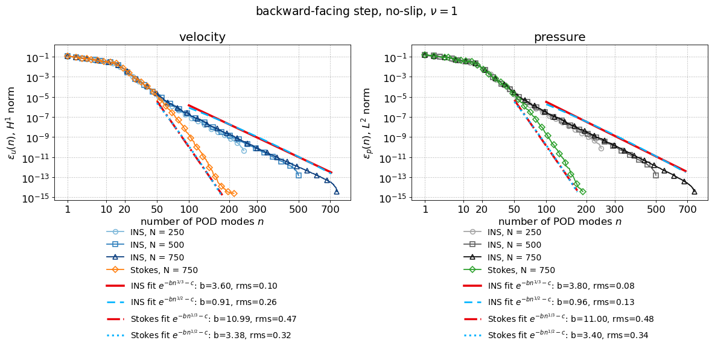</a>

**No-slip, ν = 1: mesh dependence** — [backward_mesh_rec_errors.pdf](figures/backward/backward_mesh_rec_errors.pdf)

<a href="figures/backward/backward_mesh_rec_errors.pdf">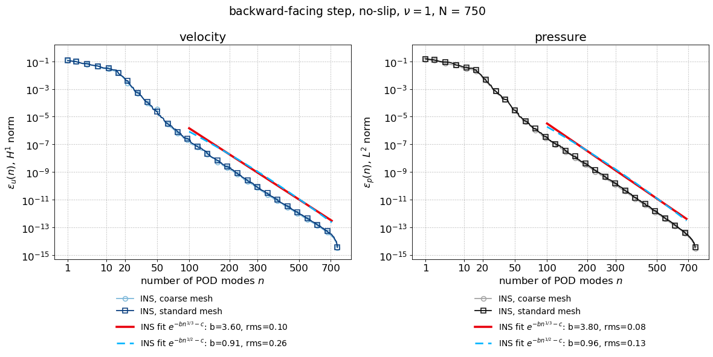</a>

**No-slip, N = 500: viscosity dependence** — [backward_viscosity_rec_errors.pdf](figures/backward/backward_viscosity_rec_errors.pdf)

<a href="figures/backward/backward_viscosity_rec_errors.pdf">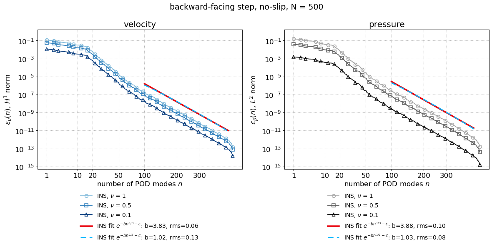</a>

**No-slip walls, do-nothing outflow, ν = 1, and Stokes** — [backward_mixed_bc_rec_errors.pdf](figures/backward_mixed_bc/backward_mixed_bc_rec_errors.pdf)

<a href="figures/backward_mixed_bc/backward_mixed_bc_rec_errors.pdf">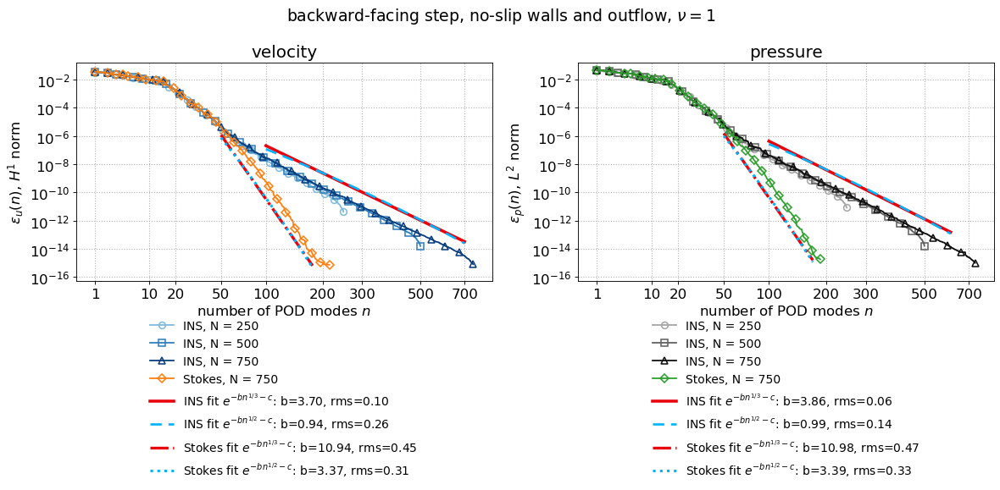</a>

**Slip walls, do-nothing outflow, ν = 1, and Stokes** — [backward_mixed_slip_rec_errors.pdf](figures/backward_mixed_slip/backward_mixed_slip_rec_errors.pdf)

<a href="figures/backward_mixed_slip/backward_mixed_slip_rec_errors.pdf">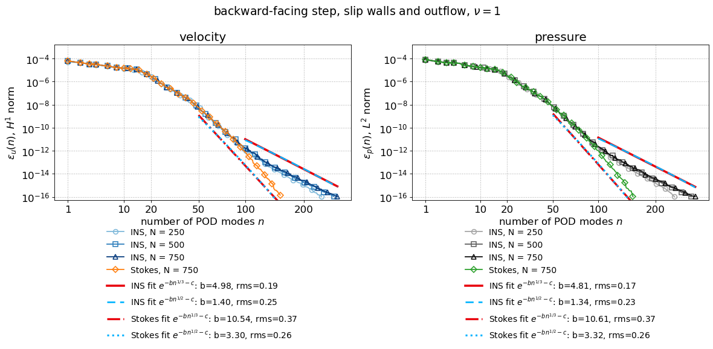</a>

**Snapshot i = 2, no-slip, ν = 1** ([figures/backward/nu_1/](figures/backward/nu_1/))

| | |
|---|---|
| <a href="figures/backward/nu_1/eig_2.pdf"></a> | <a href="figures/backward/nu_1/pressure_2.pdf">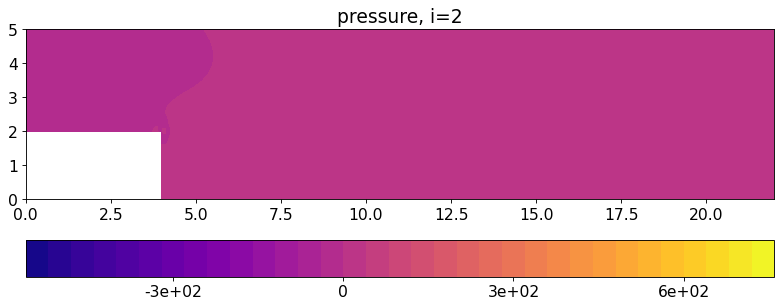</a> |
| <a href="figures/backward/nu_1/velocity_x_2.pdf">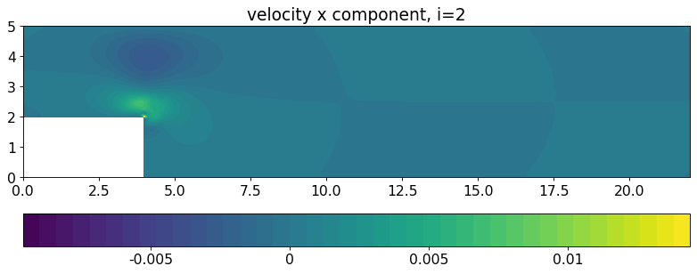</a> | <a href="figures/backward/nu_1/velocity_y_2.pdf">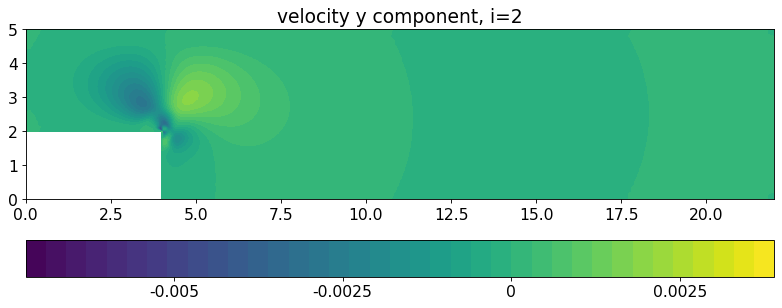</a> |

**Snapshot i = 2, no-slip walls, outflow** ([figures/backward_mixed_bc/](figures/backward_mixed_bc/))

| | |
|---|---|
| <a href="figures/backward_mixed_bc/eig_2.pdf">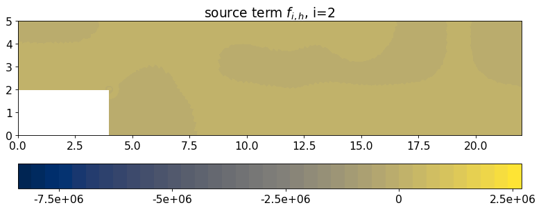</a> | <a href="figures/backward_mixed_bc/pressure_2.pdf"></a> |
| <a href="figures/backward_mixed_bc/velocity_x_2.pdf">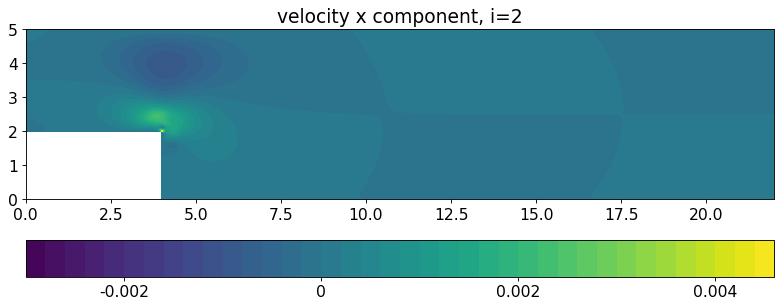</a> | <a href="figures/backward_mixed_bc/velocity_y_2.pdf"></a> |

**Snapshot i = 2, slip walls, outflow** ([figures/backward_mixed_slip/](figures/backward_mixed_slip/))

| | |
|---|---|
| <a href="figures/backward_mixed_slip/eig_2.pdf">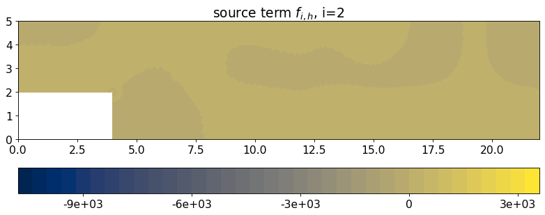</a> | <a href="figures/backward_mixed_slip/pressure_2.pdf">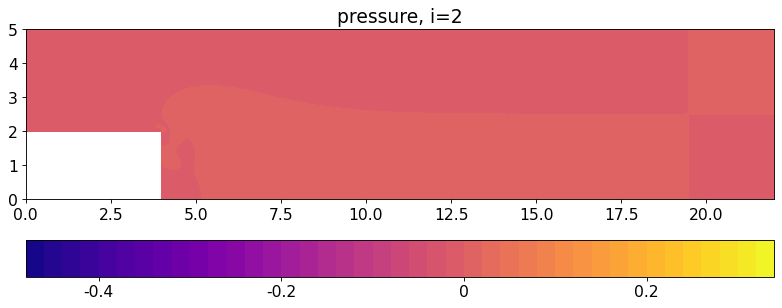</a> |
| <a href="figures/backward_mixed_slip/velocity_x_2.pdf">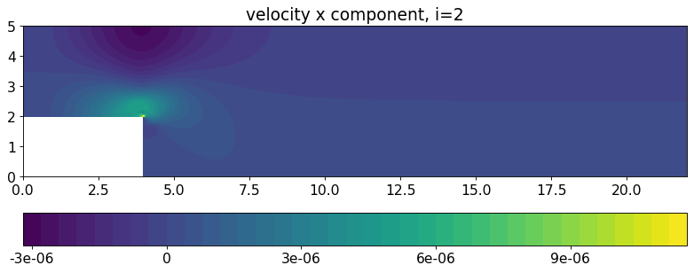</a> | <a href="figures/backward_mixed_slip/velocity_y_2.pdf">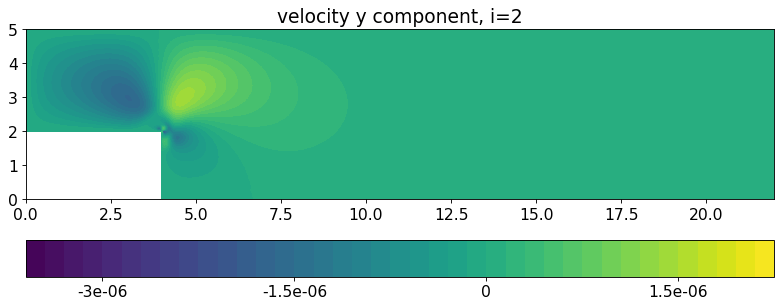</a> |

### Flow past a cube

| folder | files |
|---|---|
| [figures/cube/](figures/cube/) | cube_rec_errors, cube_mesh_rec_errors, cube_viscosity_rec_errors |
| [figures/cube/nu_1/](figures/cube/nu_1/) | eig_2, pressure_2, velocity_x_2, velocity_y_2 |
| [figures/cube_mixed_bc/](figures/cube_mixed_bc/) | cube_mixed_bc_rec_errors, eig_2, pressure_2, velocity_x_2, velocity_y_2 |
| [figures/cube_mixed_slip/](figures/cube_mixed_slip/) | cube_mixed_slip_rec_errors, eig_2, pressure_2, velocity_x_2, velocity_y_2 |

**No-slip, ν = 1, N = 250, 500, 750 training snapshots and Stokes** — [cube_rec_errors.pdf](figures/cube/cube_rec_errors.pdf)

<a href="figures/cube/cube_rec_errors.pdf">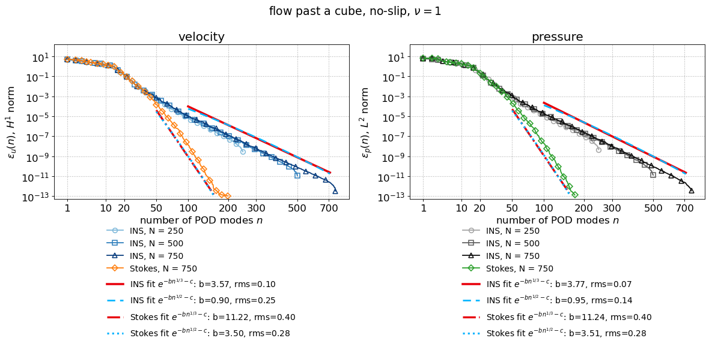</a>

**No-slip, ν = 1: mesh dependence** — [cube_mesh_rec_errors.pdf](figures/cube/cube_mesh_rec_errors.pdf)

<a href="figures/cube/cube_mesh_rec_errors.pdf">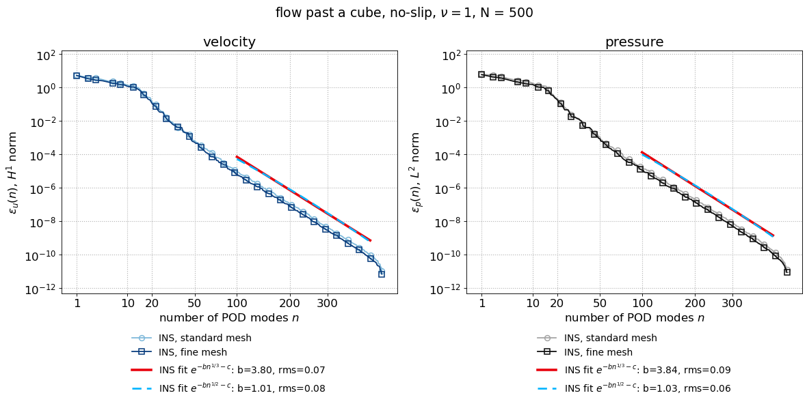</a>

**No-slip, N = 500: viscosity dependence** — [cube_viscosity_rec_errors.pdf](figures/cube/cube_viscosity_rec_errors.pdf)

<a href="figures/cube/cube_viscosity_rec_errors.pdf">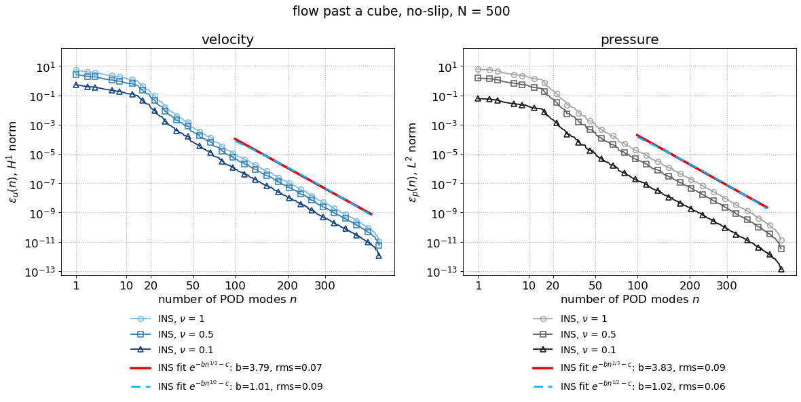</a>

**No-slip walls, do-nothing outflow, ν = 1, and Stokes** — [cube_mixed_bc_rec_errors.pdf](figures/cube_mixed_bc/cube_mixed_bc_rec_errors.pdf)

<a href="figures/cube_mixed_bc/cube_mixed_bc_rec_errors.pdf">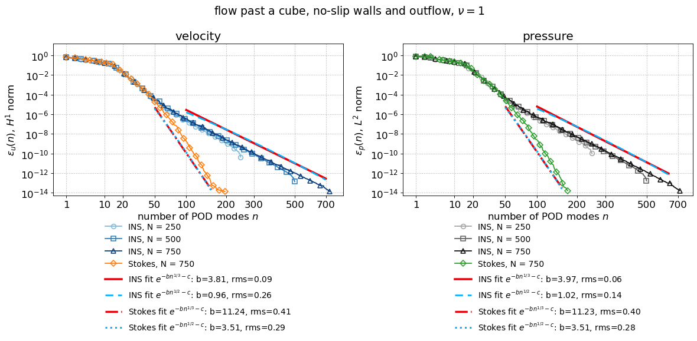</a>

**Slip walls, do-nothing outflow, ν = 1, and Stokes** — [cube_mixed_slip_rec_errors.pdf](figures/cube_mixed_slip/cube_mixed_slip_rec_errors.pdf)

<a href="figures/cube_mixed_slip/cube_mixed_slip_rec_errors.pdf">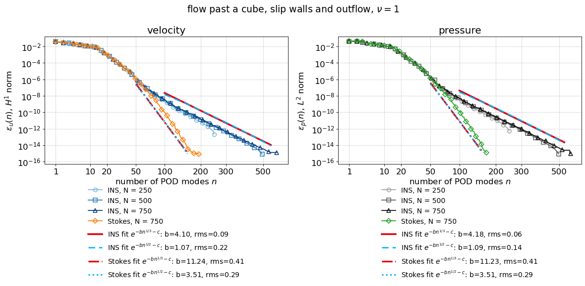</a>

**Snapshot i = 2, no-slip, ν = 1** ([figures/cube/nu_1/](figures/cube/nu_1/))

| | |
|---|---|
| <a href="figures/cube/nu_1/eig_2.pdf">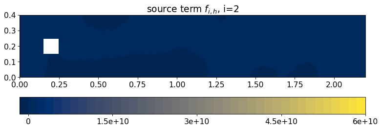</a> | <a href="figures/cube/nu_1/pressure_2.pdf">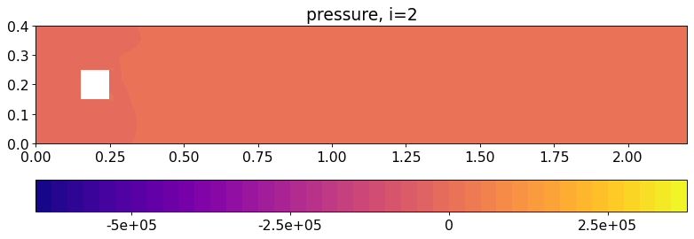</a> |
| <a href="figures/cube/nu_1/velocity_x_2.pdf">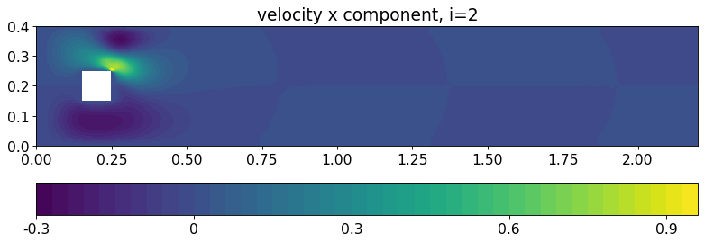</a> | <a href="figures/cube/nu_1/velocity_y_2.pdf"></a> |

**Snapshot i = 2, no-slip walls, outflow** ([figures/cube_mixed_bc/](figures/cube_mixed_bc/))

| | |
|---|---|
| <a href="figures/cube_mixed_bc/eig_2.pdf">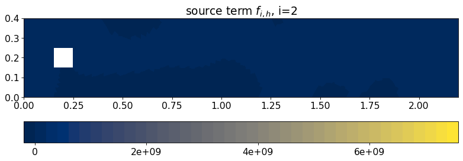</a> | <a href="figures/cube_mixed_bc/pressure_2.pdf">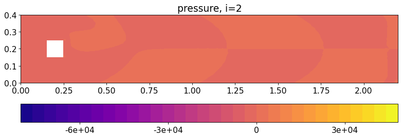</a> |
| <a href="figures/cube_mixed_bc/velocity_x_2.pdf">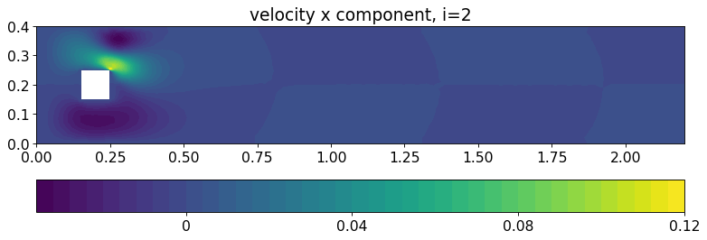</a> | <a href="figures/cube_mixed_bc/velocity_y_2.pdf">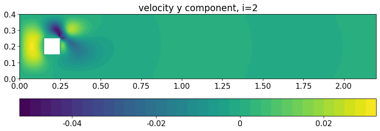</a> |

**Snapshot i = 2, slip walls, outflow** ([figures/cube_mixed_slip/](figures/cube_mixed_slip/))

| | |
|---|---|
| <a href="figures/cube_mixed_slip/eig_2.pdf">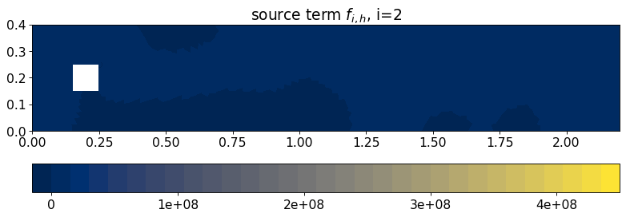</a> | <a href="figures/cube_mixed_slip/pressure_2.pdf">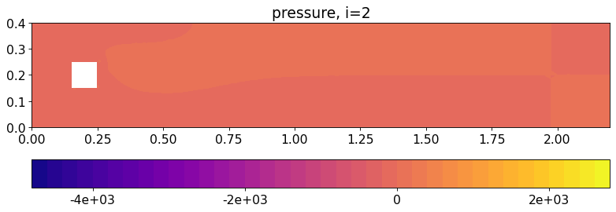</a> |
| <a href="figures/cube_mixed_slip/velocity_x_2.pdf">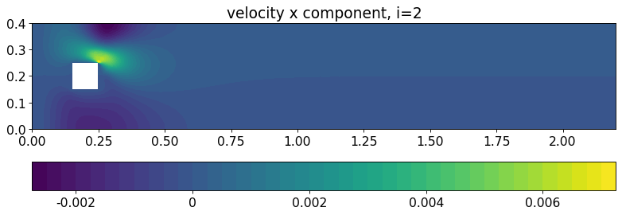</a> | <a href="figures/cube_mixed_slip/velocity_y_2.pdf">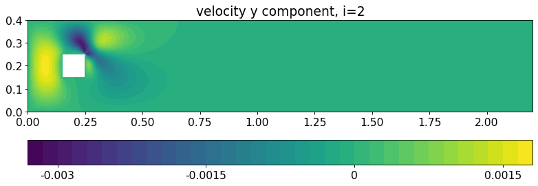</a> |


## References

1. C. Marcati and C. Schwab, Analytic regularity for the incompressible Navier–Stokes equations in polygons, *SIAM J. Math. Anal.*, 52 (2020), pp. 2945–2968. [doi:10.1137/19M1247334](https://doi.org/10.1137/19M1247334)
2. Y. He, C. Marcati and C. Schwab, Analytic regularity of solutions to the Navier–Stokes equations with mixed boundary conditions in polygons, *SIAM J. Math. Anal.*, 56 (2024), pp. 2488–2520. [doi:10.1137/22M1527428](https://doi.org/10.1137/22M1527428)

## License

Copyright 2026 Francesco Romor. Licensed under the
[Apache License, Version 2.0](LICENSE); see also [NOTICE](NOTICE).
